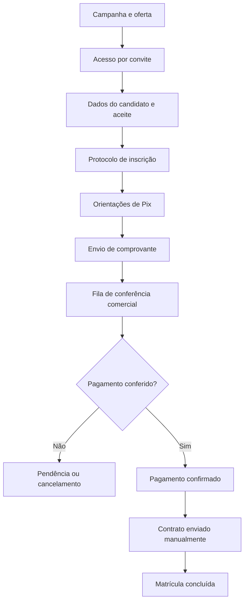
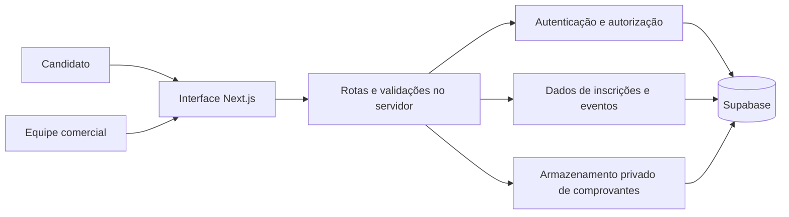

# Inscrição de Alunos | CFIC

### Da campanha à matrícula: uma experiência digital de ponta a ponta

**Landing page de campanha · Inscrição por convite · Pix com conferência manual · Gestão comercial**

**[Visão geral](#-visão-geral) · [Funcionalidades](#-funcionalidades) · [Fluxo](#-jornada-de-inscrição) · [Arquitetura](#-arquitetura-e-tecnologias) · [Status](#-estado-do-projeto)**

---

> [!IMPORTANT]
> **Este repositório é uma vitrine técnica e de produto.** Apresenta o funcionamento, as decisões de arquitetura e os recursos do sistema de inscrição de alunos. **Não inclui o código-fonte da aplicação original, credenciais, dados de estudantes ou comprovantes financeiros.** Não se trata de uma distribuição instalável.

## 📌 Visão geral

O **Inscrição de Alunos** é uma aplicação web voltada à captação e ao acompanhamento de matrículas em campanhas educacionais da **CFIC**. A proposta é reunir em uma jornada digital o contato com a oferta, o registro do candidato, o envio do comprovante de pagamento e a atuação da equipe comercial.

O produto foi concebido como **aplicação independente**, com interface responsiva e separação entre o ambiente do candidato e a área administrativa. A campanha documentada no projeto original é uma ação de **Black Friday e Natal de 2026** para uma turma de Instrumentação Cirúrgica, direcionada a contatos convidados.

### O problema que o produto resolve

Em um fluxo conduzido apenas por mensagens, os dados de interessados, os comprovantes e as confirmações de pagamento podem ficar dispersos, dificultando o acompanhamento de cada etapa. O sistema busca estruturar esse processo em um único percurso:

- **Para o candidato:** informações claras sobre a oferta, formulário objetivo, instruções de Pix e acompanhamento do pedido.
- **Para a equipe comercial:** fila de inscrições, identificação de pendências, acesso restrito a comprovantes e histórico das alterações.
- **Para a operação:** etapas explícitas, validações e separação entre o envio do comprovante, a conferência bancária e a efetivação da matrícula.

## ✨ Funcionalidades

| Área | Recurso | Como funciona |
| --- | --- | --- |
| **Campanha** | Landing page responsiva | Apresenta a oferta, o curso, as condições financeiras e o caminho para inscrição. |
| **Convites** | Acesso direcionado | Estrutura para entrada por convite, voltada aos contatos selecionados da campanha. |
| **Inscrição** | Formulário em etapas | Solicita nome, WhatsApp e e-mail, com validação e aceite das condições. |
| **Pagamento** | Orientações de Pix | Exibe separadamente a taxa de matrícula e os valores das mensalidades. **Não realiza cobrança automática.** |
| **Comprovantes** | Envio de arquivo | Fluxo preparado para receber JPG, PNG ou PDF, respeitando limite de tamanho e armazenamento privado. |
| **Acompanhamento** | Protocolo e situação | Permite acompanhar a evolução da inscrição após o envio. |
| **Comercial** | Área autenticada | Login de usuários autorizados e consulta à fila de inscrições. |
| **Operação** | Busca e filtros | Pesquisa por candidato, telefone ou protocolo e filtragem por etapa. |
| **Conferência** | Análise manual | A equipe consulta comprovantes em área restrita e confirma o crédito fora do sistema. |
| **Rastreabilidade** | Histórico de eventos | Registra mudanças de situação e observações ligadas ao andamento da matrícula. |

## 🔄 Jornada de inscrição

**O ponto central do fluxo é a validação humana:** anexar um comprovante **não significa pagamento confirmado** nem matrícula garantida. A conferência bancária e o envio do contrato continuam sob responsabilidade da equipe.

### Etapas da interface do candidato

**01 — Seus dados.** Identificação e informações de contato, apresentação das condições da oferta e aceite do aviso de privacidade.

**02 — Pix e comprovante.** Exibição da taxa de matrícula, dos dados de pagamento quando validados e do campo de envio do comprovante.

**03 — Acompanhamento.** Protocolo e evolução da solicitação, com orientação para as próximas ações da equipe comercial.

O projeto original também prevê uma **prévia navegável das três telas**, destinada à demonstração do fluxo **sem persistir informações nem receber pagamentos**.

## 🗂️ Painel comercial

A área comercial foi desenhada como uma fila operacional para que cada inscrição tenha uma situação identificável.

**Recursos implementados no código do projeto original:**

- Autenticação pelo Supabase Auth, com verificação de usuário autorizado e ativo.
- Indicadores por etapa, pesquisa textual e filtros de situação.
- Atualização periódica da fila a cada **30 segundos**, além de atualização manual.
- Consulta e download privado dos comprovantes.
- Avanço controlado entre etapas, com campo obrigatório de observação.
- Registro cronológico das decisões e acontecimentos da inscrição.
- Acesso ao WhatsApp para atendimento conduzido pela equipe.
- Interface para criação de convites pelo comercial.

### Etapas de acompanhamento

`Aguardando comprovante` → `Conferir pagamento` → `Pagamento confirmado` → `Contrato enviado` → `Matrícula concluída`

Há também situações de **pendência** e **cancelamento**. O andamento depende da ação de operadores autorizados; não há integração com confirmação automática de pagamento.

## 🧱 Arquitetura e tecnologias

O projeto é desenvolvido sobre **Next.js App Router**, com interface React e serviços no lado do servidor para validação, controle de acesso e comunicação com a camada de dados.

| Tecnologia | Aplicação no projeto |
| --- | --- |
| **Next.js 16** | Rotas da aplicação, renderização e endpoints no servidor. |
| **React 19** | Componentes interativos e fluxo de inscrição. |
| **TypeScript 6** | Tipagem da aplicação e lógica de negócio. |
| **Tailwind CSS 4** | Estilização responsiva e composição das páginas. |
| **Motion** | Animações e transições da experiência visual. |
| **Supabase** | Estrutura prevista para autenticação, persistência e armazenamento privado. |
| **PostgreSQL** | Modelo relacional e migrações SQL da camada de dados. |
| **Vercel** | Plataforma de implantação prevista para o front-end e serviços Next.js. |

### Separação de responsabilidades

A camada servidor é responsável por proteger operações sensíveis. O modelo evita disponibilizar credenciais administrativas, arquivos enviados ou registros de estudantes como recursos públicos.

## 🔐 Segurança e privacidade

O escopo técnico contempla controles importantes para uma aplicação que lida com dados pessoais e comprovantes:

- **Acesso ao comercial condicionado à autenticação e à autorização.**
- **Chaves privilegiadas restritas ao ambiente do servidor.**
- **Comprovantes em armazenamento privado**, com download mediado por rotas protegidas.
- **Validação dos dados de cadastro e dos arquivos enviados.**
- **Consentimento para as condições da inscrição e aviso de privacidade.**
- **Histórico de mudanças de estado**, permitindo rastrear decisões operacionais.
- **Bloqueios de ativação** quando faltam configurações obrigatórias da campanha.

> A inclusão dessas proteções no código não equivale, por si só, a uma auditoria independente de segurança ou à homologação de produção. Antes de tratar inscrições reais, são necessárias configuração, validação e revisão operacional.

## ✅ Qualidade e validação

O repositório original contém testes automatizados para áreas essenciais da solução, incluindo **validações de dados**, **convites** e **comportamento da camada de banco de dados em ambiente isolado**.

A validação técnica também prevê verificação de tipos e build da aplicação. Esses testes contribuem para a consistência do produto, mas **não substituem testes ponta a ponta no serviço Supabase real**, nem a conferência do fluxo financeiro e de privacidade antes do lançamento.

## 🚦 Estado do projeto

**Estado documentado no código original:** aplicação e painel comercial desenvolvidos; prévia de inscrição disponível; **inscrições reais ainda condicionadas à configuração e à validação do ambiente e da campanha**.

| Item | Situação documentada |
| --- | --- |
| Landing page e apresentação da campanha | Implementado |
| Prévia das três etapas, sem operações reais | Implementado |
| Formulário, convites e fluxo de comprovante | Implementados no código; dependem de configuração para uso real |
| Painel comercial com autenticação e acompanhamento | Implementado no código; depende de usuários e banco configurados |
| Confirmação automática via gateway ou webhook | **Não faz parte do escopo** |
| Conferência de pagamento e envio do contrato | **Procedimentos manuais** |
| Abertura pública de inscrições reais | **Pendente de configuração e validação** |

Essa distinção faz parte da documentação: o showcase demonstra **o que foi desenvolvido** sem afirmar que uma integração ou uma operação real já foi homologada.

## 🎨 Experiência e decisões de produto

A interface foi pensada para combinar uma **apresentação comercial visual** com um fluxo de inscrição direto. O conceito inclui campanha temática, destaque transparente para o desconto, leitura facilitada em dispositivos móveis, indicadores de progresso e mensagens específicas em cada etapa.

Um requisito importante é **não confundir interesse com matrícula concluída**: a experiência informa o usuário sobre os passos restantes, enquanto a equipe comercial mantém o controle das verificações e aprovações.

## 📷 Demonstração visual

O showcase prioriza a apresentação do sistema sem disponibilizar sua implementação privada. As telas de maior interesse para uma apresentação de portfólio são:

1. **Página da campanha:** proposta visual, oferta e chamada para inscrição.
2. **Cadastro:** formulário e condições da oferta.
3. **Pagamento e comprovante:** fluxo de orientação ao candidato.
4. **Acompanhamento:** protocolo e situação da inscrição.
5. **Painel comercial:** fila, filtros, histórico e ações operacionais.

> Capturas de tela poderão ser adicionadas aqui somente após revisão para remover nomes, contatos, dados bancários, informações de estudantes e outras informações sensíveis. Nenhuma imagem foi incluída sem um arquivo de demonstração verificado.

## 👨‍💻 Autoria

**Desenvolvimento e organização do projeto:** Jonas Pessoa  
**GitHub:** [@jonascepa09-star](https://github.com/jonascepa09-star)

Este repositório documenta um projeto de software para fins de **portfólio profissional**, com foco em experiência do usuário, arquitetura web, fluxos de matrícula e ferramentas para a equipe comercial.

---

**Inscrição de Alunos — Showcase técnico e funcional**

*Uma experiência de captação e matrícula mais organizada, rastreável e orientada ao usuário.*

